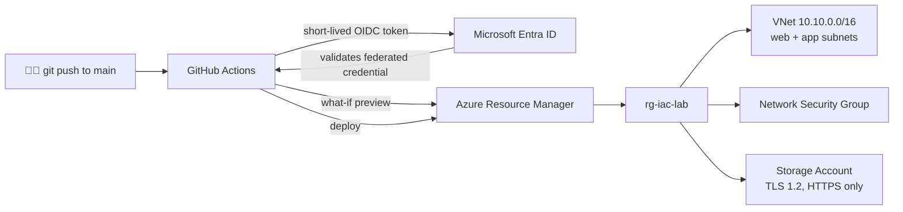

# ☁️ Azure Infrastructure as Code with GitHub Actions + OIDC


-success)


> **Push code, and Azure builds itself.** Azure networking and storage are defined in Bicep and deployed automatically by GitHub Actions. The pipeline logs in with **passwordless OIDC federation**, so the repo stores no client secrets and no long-lived credentials.

---

## 🏗️ Architecture



## 📦 What gets deployed

| Resource | Details |
|---|---|
| **Virtual Network** | `10.10.0.0/16` with `web` (10.10.1.0/24) and `app` (10.10.2.0/24) subnets |
| **Network Security Group** | Attached to the `web` subnet |
| **Storage Account** | StorageV2, LRS, TLS 1.2 minimum, HTTPS only, public blob access **disabled**, globally unique name via `uniqueString()` |

## 🔐 Security highlights

- **No stored secrets.** GitHub requests a short-lived token, and Entra ID only trusts it when the repo, branch, and issuer match a federated credential.
- **Least privilege.** The service principal has **Contributor on a single resource group**, with no access anywhere else in the subscription.
- **Preview before every deploy.** `az deployment group what-if` shows exactly what will change before anything is touched.
- **Hardened storage defaults** are enforced in code, not left to portal clicks.

## ⚙️ How the pipeline works

1. A push that changes anything in `infra/` triggers the workflow. It can also be run manually.
2. `azure/login@v2` exchanges GitHub's OIDC token for an Azure access token.
3. The **what-if** step previews the changes.
4. The **deploy** step applies the Bicep template. Because deployments are **idempotent**, re-running with no changes changes nothing.

```
.
├── infra/
│   └── main.bicep              # VNet, NSG, Storage
└── .github/workflows/
    └── deploy.yml              # OIDC login → what-if → deploy
```

## 🛠️ Problems I solved

**1. OIDC subject mismatch (`AADSTS700213`)**
Login failed because GitHub now sends an **immutable, ID-based subject claim**:
`repo:<owner>@<owner-id>/<repo>@<repo-id>:ref:refs/heads/main`
The federated credential was configured with the older `repo:<owner>/<repo>` format. I read the presented subject from the error, rebuilt the credential to match, and login succeeded.

**2. Region blocked by policy (`RequestDisallowedByAzure`)**
The Azure for Students subscription only allows deployments to an approved list of regions. I queried the policy assignment for the allowed locations and pinned the template's `location` to an approved region (`eastus2`). This also shows that a resource group's region and its resources' regions can differ.

**3. Bicep syntax error (`BCP018`)**
While adding the `app` subnet, a missing closing brace broke the build. The what-if stage caught it **before anything was deployed**, which is exactly why the preview gate exists.

## 📸 Screenshots

| Pipeline run | What-if preview | Deployed resources |
|---|---|---|
|  |  |  |

## 🚀 Reproduce it

```bash
# 1. Resource group
az group create --name rg-iac-lab --location eastus2

# 2. App registration + service principal
APP_ID=$(az ad app create --display-name github-iac-lab --query appId -o tsv)
az ad sp create --id $APP_ID

# 3. Least-privilege role on the resource group only
az role assignment create --assignee $APP_ID --role Contributor \
  --scope /subscriptions/<SUB_ID>/resourceGroups/rg-iac-lab

# 4. Federated credential (copy the exact subject from GitHub's OIDC error/claims)
az ad app federated-credential create --id $APP_ID --parameters '{
  "name":"github-main",
  "issuer":"https://token.actions.githubusercontent.com",
  "subject":"repo:<owner>@<owner-id>/<repo>@<repo-id>:ref:refs/heads/main",
  "audiences":["api://AzureADTokenExchange"]}'
```

Then add `AZURE_CLIENT_ID`, `AZURE_TENANT_ID`, and `AZURE_SUBSCRIPTION_ID` as repository secrets, and run the workflow.

**Cleanup:**
```bash
az group delete --name rg-iac-lab --yes --no-wait
az ad app delete --id $APP_ID
```

## 🧭 What's next

- [ ] Add NSG rules and a VM behind Azure Bastion
- [ ] Hub-and-spoke network with Azure Firewall and UDRs
- [ ] Azure Policy and management groups deployed as code
- [ ] Microsoft Sentinel with KQL detections

---

**Adam** · AZ-104 · Security+ · Network+ · [GitHub @thehacker924](https://github.com/thehacker924)
